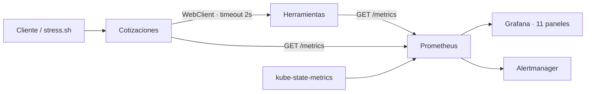

# JardínRent · Microservicios Java y monitoreo en Kubernetes

Proyecto individual de **Lucía Sánchez Miranda**, creado desde cero. Cotizaciones consulta a Herramientas por HTTP para verificar disponibilidad y calcular el alquiler de herramientas de jardinería. Sin bases de datos, plantillas del taller ni dependencias de BerryControl.



## Stack e independencia

Java **17**, Spring Boot **3.5.16**, Maven, WebFlux, Actuator y Micrometer. Almacenamiento mediante `ConcurrentHashMap`. Dockerfiles de dos etapas Maven/JDK 17 → JRE 17 y usuario sin privilegios. Minikube con perfil exclusivo **`jardinrent`**, Kubernetes **1.34.0**, runtime Docker; Helm **kube-prometheus-stack 92.11.0**. APIs en namespace `jardinrent`; monitoreo en `monitoring`. Todos los comandos usan contexto explícito y conservan el contexto anterior.

## Instalación y ejecución completa

Comandos de instalación para una máquina Windows/Ubuntu nueva: [docs/instalacion.md](docs/instalacion.md).

Desde Ubuntu/WSL, con Docker Desktop iniciado e integración habilitada:

```bash
git clone https://github.com/LuciaSanchezMiranda/jardinrent-microservices-monitoring.git
cd jardinrent-microservices-monitoring
git switch develop
export GRAFANA_ADMIN_PASSWORD='TuClavePropiaDeLaboratorio'
bash scripts/setup.sh
```

`setup.sh` verifica prerequisitos, inicia el perfil, habilita Metrics Server, instala el monitoreo, construye y prueba ambas imágenes **dentro de Minikube**, aplica manifiestos, provisiona el dashboard y comprueba los targets UP. No requiere Java ni Maven en el host para los builds Docker. La primera ejecución descarga imágenes y dependencias. Recursos iniciales: cuatro CPU y 6 GiB para Minikube, además de Windows y otras aplicaciones; se ajustan con `CLUSTER_CPUS` y `CLUSTER_MEMORY`.

Al repetir setup se reutiliza el nodo en ejecución, pero se reinician las APIs para cargar las imágenes construidas. Sus datos en memoria se restablecen.

| Componente | URL mediante port-forward |
| --- | --- |
| Herramientas | http://localhost:18081/herramientas |
| Cotizaciones | http://localhost:18082/cotizaciones |
| Grafana | http://localhost:13000/d/jardinrent-overview |
| Prometheus targets | http://localhost:19090/targets |
| Alertas | http://localhost:19090/alerts |

**Grafana:** usuario `admin`, contraseña de `GRAFANA_ADMIN_PASSWORD`. Si no se define, la clave demo local es `JardinRent-Lab2026!`. La contraseña elegida se configura en un Secret, no se publica en los manifiestos. Las APIs no tienen login.

Los Services son **NodePort**: Herramientas 31081, Cotizaciones 31082, Grafana 32000 y Prometheus 32001. Los port-forwards dan acceso desde Windows/WSL cuando la IP del nodo Docker no es alcanzable. Si se reinicia WSL, ejecutar `bash scripts/access.sh`. Alternativa: `minikube -p jardinrent service herramientas -n jardinrent --url`. Las URLs requieren mantener el clúster y los procesos de acceso activos.

## Endpoints

| Servicio | Método y ruta | Función |
| --- | --- | --- |
| A | `GET /herramientas` | Listar catálogo. |
| A | `GET /herramientas/{id}` | Consultar tarifa y stock. |
| A | `POST /herramientas` | Crear herramienta (201). |
| A | `PATCH /herramientas/{id}/stock` | Actualizar disponibilidad no negativa. |
| B | `GET /cotizaciones` | Listar cotizaciones. |
| B | `GET /cotizaciones/{id}` | Consultar cotización. |
| B | `POST /cotizaciones` | Consultar A y calcular importe (201). |
| B | `DELETE /cotizaciones/{id}` | Eliminar cotización (204). |
| Ambos | `GET /health` | Salud propia, sin dependencia ni delay. |
| Ambos | `GET /metrics` | Scraping de Prometheus. |

```bash
curl -fsS -H 'Content-Type: application/json' \
  -d '{"herramientaId":"1","dias":3}' http://localhost:18082/cotizaciones

curl -fsS -H 'Content-Type: application/json' \
  -d '{"nombre":"Rastrillo","tarifaDiaria":8.50,"disponibles":5}' \
  http://localhost:18081/herramientas
```

Datos iniciales: podadora `1`, S/25 por día, diez unidades; desbrozadora `2`, S/35, cuatro unidades. Una podadora por tres días cuesta S/75.00. Las cotizaciones **no son reservas** y no descuentan inventario. Los reinicios borran los datos del proceso y A restaura su catálogo inicial.

Errores controlados con `ProblemDetail`: validación 400, inexistente 404, stock cero 409, dependencia inaccesible 503 y timeout 504. Las incidencias se registran en logs y métricas.

## Variables

| Variable | Uso | Inicial |
| --- | --- | --- |
| `SERVER_PORT` | Ambos servicios | 8080 |
| `RESPONSE_DELAY_MS` | Consultas de A; no salud ni métricas | 0, máximo 60000 |
| `HERRAMIENTAS_URL` | WebClient de B | `http://herramientas:8080` en Kubernetes |
| `HERRAMIENTAS_TIMEOUT_MS` | Timeout de B | 2000 |
| `GRAFANA_ADMIN_PASSWORD` | Instalación del Secret | Clave demo anterior si se omite |
| `PROFILE` | Scripts | `jardinrent`, sólo perfiles con este prefijo |

## Métricas propias

| Servicio | Counter | Gauge | Timer con histograma |
| --- | --- | --- | --- |
| A | `herramientas_solicitudes_total` | `herramientas_disponibles`, `herramientas_stock`, `herramientas_delay_seconds` | `herramientas_solicitud_seconds_*` |
| B | `cotizaciones_solicitudes_total`, `cotizaciones_rechazadas_total`, `cotizaciones_timeouts_total`, `cotizaciones_dependencia_errores_total` | `cotizaciones_activas` | `cotizaciones_solicitud_seconds_*` |

Cada servicio cumple cuatro métricas y los tres tipos mínimos. El Timer registra también solicitudes fallidas. Las etiquetas de operación son finitas y no contienen UUID de cada petición.

## Casuísticas, informe y evidencias

- [Tres casuísticas completas y comandos](docs/casuisticas.md).
- [Informe A–D y PromQL](docs/informe.md).
- [Dashboard JSON](docs/dashboard.json), provisionado por `setup.sh` e importable en Grafana.
- [Índice de evidencias reales y validación](docs/evidencias/README.md).

```bash
bash scripts/scenario.sh crash
bash scripts/scenario.sh crash-fix
bash scripts/scenario.sh slow
bash scripts/scenario.sh slow-fix
bash scripts/scenario.sh stock
bash scripts/scenario.sh stock-fix
# Ejecutar tráfico durante cada incidencia para observar las alertas:
bash load-testing/stress.sh http://localhost:18082 120 4
```

Alertas: `HerramientasCaido`, `CotizacionesCaido`, `CotizacionesConTimeout`, `HerramientaSinStock`. Se usa una réplica y estrategia `Recreate` para que una versión anterior no oculte la primera casuística. Es un laboratorio de observabilidad, no alta disponibilidad para producción.

## Pruebas y ejecución sin Kubernetes

Con JDK 17 y Maven:

```bash
mvn clean verify
SERVER_PORT=8081 mvn -pl microservices/herramientas-service spring-boot:run
# Otra terminal:
SERVER_PORT=8082 HERRAMIENTAS_URL=http://localhost:8081 \
  mvn -pl microservices/cotizaciones-service spring-boot:run
```

Nueve pruebas comprueban APIs de catálogo, validación, salud y métricas; cálculo de cotización mediante HTTP real contra un servidor de prueba, lectura/eliminación, 404, 409, 503 y timeout 504. Los Dockerfiles ejecutan las pruebas con JDK 17. `scripts/verify.sh` verifica las APIs desplegadas y ambos targets reales. CI repite pruebas con Java 17.

## Apagado

```bash
bash scripts/teardown.sh                  # conserva el clúster
bash scripts/teardown.sh --delete-cluster # elimina el perfil exclusivo
```

No elimina otros perfiles ni recursos de BerryControl. Los scripts verifican sus prerequisitos y se detienen con explicación si falta una herramienta.

## Entrega

Repositorio: https://github.com/LuciaSanchezMiranda/jardinrent-microservices-monitoring

Se desarrolla en `develop` con Conventional Commits en inglés y se propone mediante PR hacia `main`. Si Classroom requiere un PR en un repositorio institucional, el docente debe proporcionar ese destino; el PR de este repositorio no sustituye esa indicación.
